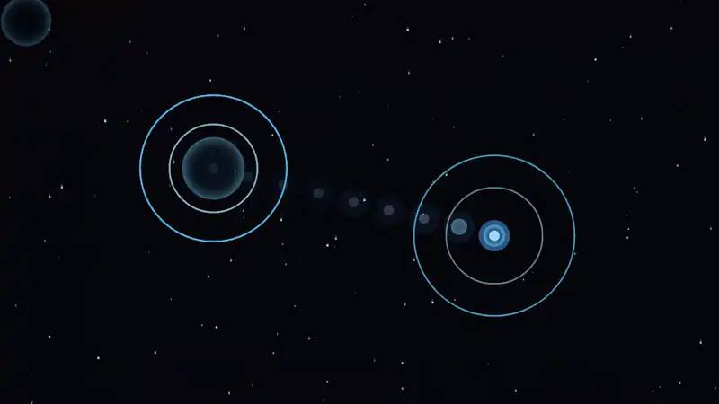
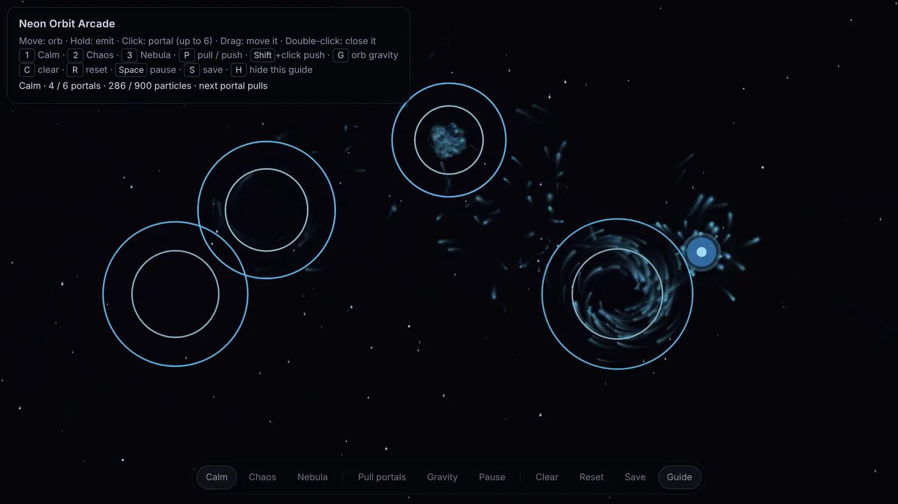
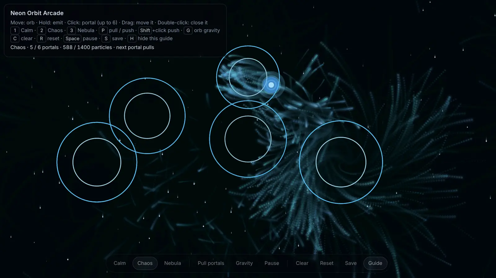
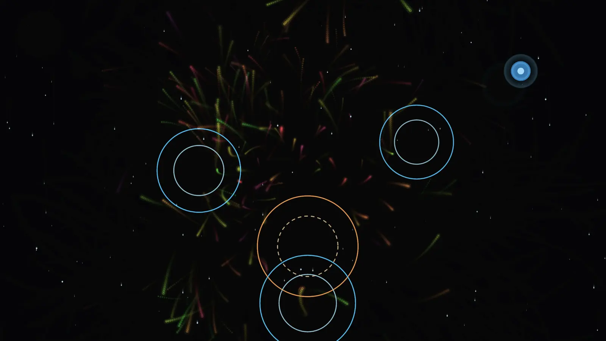
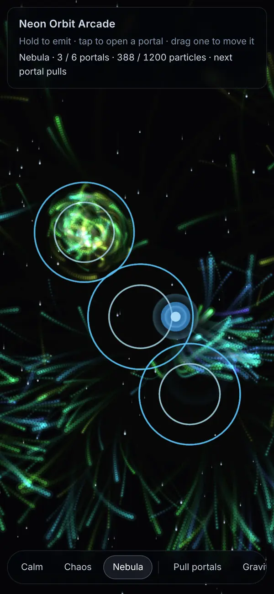
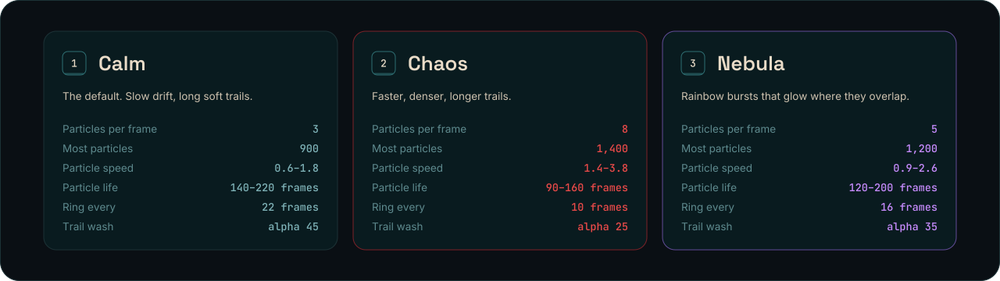
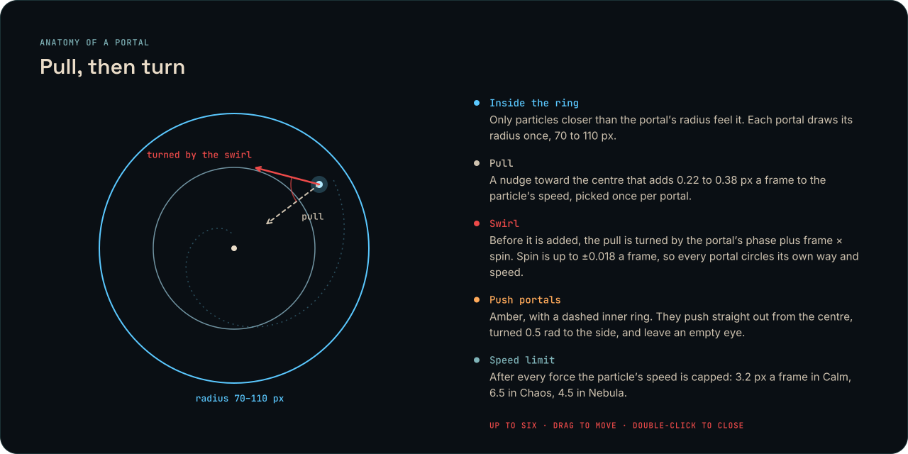

<p align="center">
  <a href="https://neon-orbit.rayhanson.tech/"></a>
</p>

<p align="center">
  <a href="https://neon-orbit.rayhanson.tech/"></a>
  
  
  
  
  
</p>

<p align="center">
  <a href="#about">About</a> ·
  <a href="#controls">Controls</a> ·
  <a href="#calm-chaos-and-nebula">Modes</a> ·
  <a href="#portals">Portals</a> ·
  <a href="#how-it-works">How it works</a> ·
  <a href="#run-it-locally">Run it locally</a> ·
  <a href="#status-and-limits">Status and limits</a> ·
  <a href="#changelog">Changelog</a>
</p>

## About

Neon Orbit Arcade explores how a few simple inputs can make a screen feel alive. Your cursor becomes a glowing orb
that sends out soft rings as it moves. Hold the mouse and it leaves a trail of particles. Click, and a portal opens:
a ring that catches nearby particles and swirls them into a small moving system. Push portals do the opposite and
blow a clear eye in the middle of the swarm. One key shifts the whole scene from calm to chaos, or into Nebula,
where rainbow bursts glow brighter wherever they overlap.

It was the final project for MTEC 1201, built around **loops** (every star, particle, ring and portal is updated each
frame), **arrays** (one list for each) and **classes** (`Particle`, `Ring`, `Portal` and `Star`).

<p align="center">
  
</p>

<p align="center"><sub>Recorded from the sketch itself in a headless browser: three portals and a sweep in Calm, then Chaos, then Nebula with a push portal and orb gravity.</sub></p>

## Controls

Every key has a button on the dock at the bottom of the screen. The dock stays dim so it doesn't compete with the
scene, and brightens when you point at it; on touch screens it is always fully visible.

| Input | Dock | What it does |
|---|---|---|
| **Move** the mouse | | The orb follows and sends out a soft ring every few frames. |
| **Hold** the mouse | | Emits particles from the orb: 3, 8 or 5 a frame, depending on the mode. |
| **Click** or **tap** | | Opens a portal where you click, up to **six**. When all six are open, a red ring says so. |
| <kbd>Shift</kbd> + **click** | | Opens a push portal, whichever kind <kbd>P</kbd> is set to. |
| **Drag** a portal | | Grab a portal by its middle and move it. |
| **Double-click** or **double-tap** a portal | | Closes it. |
| <kbd>1</kbd> <kbd>2</kbd> <kbd>3</kbd> | Calm · Chaos · Nebula | Switches the mode. |
| <kbd>P</kbd> | Pull / Push portals | What the next click opens: a pull portal or a push portal. |
| <kbd>G</kbd> | Gravity | Orb gravity: the orb pulls nearby particles along behind it. |
| <kbd>Space</kbd> | Pause | Freezes the particles, rings and stars. |
| <kbd>C</kbd> | Clear | Clears particles and rings. Portals stay. |
| <kbd>R</kbd> | Reset | Resets everything: portals, mode (back to Calm), portal kind and gravity. |
| <kbd>H</kbd> | Guide | Hides or shows the guide in the corner. |
| <kbd>S</kbd> | Save | Saves the canvas as `neon-orbit-arcade.png`. |

As in the original, pressing the mouse on an empty spot both opens a portal there and starts emitting, so a long
press leaves a portal with its own swirl of particles. Pressing on an open portal grabs it instead. The mode, the
portal kind and orb gravity are remembered in your browser between visits.

<table>
  <tr>
    <td width="50%"></td>
    <td width="50%"></td>
  </tr>
  <tr>
    <td align="center"><sub><b>Calm.</b> Particles drift and the portals gather them slowly.</sub></td>
    <td align="center"><sub><b>Chaos.</b> More particles, faster, with longer trails.</sub></td>
  </tr>
  <tr>
    <td width="50%"></td>
    <td width="50%" align="center"></td>
  </tr>
  <tr>
    <td align="center"><sub><b>Nebula, with a push portal.</b> The amber ring keeps its middle clear.</sub></td>
    <td align="center"><sub><b>On a phone.</b> Taps, a drag and the dock only.</sub></td>
  </tr>
</table>

## Calm, Chaos and Nebula

<p align="center">
  
</p>

Calm and Chaos are the original two modes, with their original numbers. **Nebula** is new. Each particle is born with
a hue that sweeps slowly around the colour wheel, so every burst has its own colour, and particles are drawn with
additive blending: where trails cross, their colours add up and glow towards white.

## Portals

<p align="center">
  
</p>

Every portal picks its own radius (70 to 110 px), strength (0.22 to 0.38) and spin when it opens. A **pull portal**
works exactly as in the original: for every particle inside its ring it computes a nudge towards the centre, turns that
nudge by the portal's phase plus the frame count times its spin, and adds it to the particle's velocity. Because the
turn keeps changing, particles don't fall straight in; they circle, bunch up and get flung back out, which is what
makes each portal look alive.

A **push portal** (amber, with a dashed inner ring) pushes straight out from its centre instead, turned half a radian
to the side so the escaping particles curl. A swarm that reaches one opens around an empty eye.

## How it works

Every frame, in order:

1. **Wash.** The canvas is painted with the background colour at a low alpha (45, 25 or 35 by mode), which fades what
   was drawn before. That is where the trails come from.
2. **Stars.** 140 stars twinkle and fall slowly (0.08 to 0.35 px a frame), wrapping back to the top.
3. **Rings and emission.** Every 22, 10 or 16 frames the orb sends out a ring. While the mouse is held, new particles
   are born at the orb, up to the mode's limit.
4. **Particles.** Each particle feels every portal and, with orb gravity on, the orb. It then turns a little by
   Perlin noise, moves, fades by 1.3 life a frame and wraps around the edges. Its speed is capped after every force.
5. **Rings and orb.** Rings grow and fade, then the orb is drawn on top.

**Orb gravity** reaches 260 px. Its pull is 0.12 at the orb and falls off in a straight line to nothing at the edge
of its reach, so particles trail the orb like a comet's tail rather than collapsing onto it.

### Accessibility

- With **Reduce motion** on, the orb sends out no rings and the stars hold still. Everything you do yourself still
  works.
- The guide and the dock are ordinary page elements: screen readers read them, the buttons work from the keyboard with
  visible focus, and toggles report their state.
- <kbd>Space</kbd> never scrolls the page, and touch screens don't scroll or zoom while you play.

## Run it locally

There is nothing to install or build. p5.js loads from jsDelivr, pinned to version 1.9.4.

```bash
git clone https://github.com/Rayhanson-Git/neon-orbit-final.git
cd neon-orbit-final
python3 -m http.server 8000
```

Then open <http://localhost:8000>. Opening `index.html` directly from the file system also works.

## Project layout

```text
index.html        the page: p5.js from jsDelivr, the guide, the dock, meta and social tags
sketch.js         the whole sketch: modes, p5 hooks, actions, the dock, and the Particle, Ring, Portal and Star classes
style.css         full-screen canvas, the guide panel and the dock
favicon.svg       the tab icon
assets/           README images: hero, diagrams, screenshots, the demo recording and the social preview
design/           the script that draws the SVGs in assets/ (npm install && npm run build)
docs/             a redirect from the repository's GitHub Pages address to neon-orbit.rayhanson.tech
```

The SVG illustrations are written by [`design/artwork.mjs`](design/artwork.mjs) in the Rayhanson palette, with every
word turned into outlines so they look the same on GitHub as anywhere else. Every number in them comes from
`sketch.js`. The screenshots and the recording come from the real sketch, driven with mouse, touch and keyboard input
in a headless browser.

## Status and limits

- **Chaos at its limit is heavy.** 1,400 particles, each feeling six portals, is the most work the sketch does. A
  recent laptop keeps up; an older phone may slow down. Calm and Nebula stay lighter.
- **Double-clicking an empty spot** opens a portal on the first click and closes it on the second, leaving only a red
  ring. Double-click (or double-tap) a portal you want to close, not empty space.
- **It needs a network connection the first time**, to load p5.js from jsDelivr.

## Changelog

**November 2026: the upgrade.** The December 2025 final project, grown into a fuller playground. The original
controls and numbers are kept: Move, Hold, Click (up to six portals), 1, 2, C and R. The one change is that pressing
on an open portal now grabs it to move it, instead of opening a second portal on top of it.

- **Nebula** (<kbd>3</kbd>): a third mode with rainbow particles drawn with additive blending.
- **Push portals** (<kbd>P</kbd>, or <kbd>Shift</kbd> + click): amber portals that push particles out and leave a clear eye.
- **Move and close portals**: drag a portal by its middle; double-click or double-tap to close it.
- **Orb gravity** (<kbd>G</kbd>): the orb pulls particles along behind it.
- **The dock**: every control as a button, so it plays on phones and tablets too.
- **Remembered settings**: mode, portal kind and gravity are kept between visits.
- Pause (<kbd>Space</kbd>), hide the guide (<kbd>H</kbd>), save a PNG (<kbd>S</kbd>), a live status line, Reduce Motion
  support, a red ring when all six portals are open, a favicon, and meta and social-preview tags.
- Fixed: the orb and its rings appeared in the top-left corner before the pointer first moved.
- Fixed: stars were not rebuilt when the window was resized, leaving empty areas.
- Faster: particles keep their colour as plain numbers instead of building a `p5.Color` every frame, drawing no longer
  pushes and pops the style for every particle, and portals compare squared distances.
- Changed: the guide moved from canvas text to an HTML panel. The README's placeholder live link is now the real one.

## Credits

Made by Harvey Rayhanson ([rayhanson.tech](https://rayhanson.tech)) with [p5.js](https://p5js.org). Its sibling
sketch is [Orbit Playground](https://github.com/Rayhanson-Git/orbit_playground). No licence has been chosen for this
repository, so all rights are reserved.
